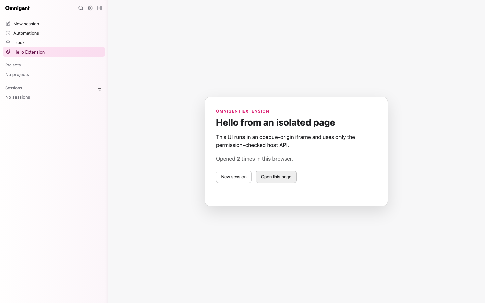

# Extensions

Omnigent extensions are operator-installed Python distributions that contribute
validated application metadata. V1 supports namespaced browser views, external
web pages, and links in the primary sidebar.

## Trust model

Installing a Python distribution is a full-code-trust operation: Python entry
points execute in the Omnigent server process while their manifests are loaded.
Only administrators should install extension packages.

Browser views receive a separate boundary. Each runs in an opaque-origin
sandboxed iframe, cannot access the parent React tree, cookies, authenticated
transport, or native bridges, and has no network egress. Privileged actions use
the versioned, permission-checked browser SDK.

```text
trusted Python package -> validated manifest -> server catalog
                                                |
                                      sandboxed browser page
                                                |
                                      checked MessageChannel API
```

External pages require the `pages.external` permission. The host frames the
specified HTTP or HTTPS URL directly by default.
The document runs in its own origin and can use its own network and storage.
It has no browser SDK or host RPC access. The frame allows scripts, same-origin
access, forms, and popups, but grants no top navigation, downloads, or device
features. It sends no referrer. Declared URLs on the application's own origin
are refused because scripts with same-origin access could remove the sandbox.

This check covers the declared URL only: the site can redirect or navigate its
frame, including to the application's origin. Such a navigation loads the
application's own content; the host does not prevent it. Declare only sites
trusted by the operator. Sites can also refuse framing through their response
headers; the toolbar remains available to open them separately.

An operator-trusted page can opt into [server proxying](extension_manifest.md#server-proxied-pages)
with the additional `pages.proxy` permission. Its scripts run on Omnigent's origin
and can access the application's authenticated browser context. Trust the upstream
as fully as installed extension code; this mode provides connectivity, not browser
isolation. The server exposes exact method/path pairs, checks the origin of writes,
strips browser credentials, and refuses upstream redirects.

An HTTPS application does not embed HTTP pages, including loopback URLs. It
shows an explanation and buttons to open the page in a window or a new tab.
The window button requests a 480 by 720 popup; browser policies may open a tab
instead. In the desktop application, external origins outside the popup
allowlist open in the default browser.

## V1 contribution points

- `pages`: one-segment routes under `/extensions/{extension_id}/{route}`,
  using `PageContribution` for a sandboxed browser view or
  `ExternalPageContribution` for an external web page.
- `primary_navigation`: links rendered in the extension-owned slot between
  Inbox and Usage. `order` sorts only within that slot.

Command metadata, activation events, and `when` expressions are validated and
reserved but are not executed or evaluated in V1. Arbitrary React components,
DOM selectors, FastAPI routers, runner tools, and user-installed marketplace
packages are not supported.

## Installation and diagnostics

Declare an `omnigent.extensions` entry point, install the wheel in the server's
Python environment, and restart the server. Installation implies enablement for
V1; there is no separate enable switch.

```bash
omni extensions list
omni extensions doctor publisher.extension
```

A broken extension does not stop healthy extensions or the server. Public
catalog entries omit rejected extensions. Administrators can inspect concise
load and asset errors through `doctor` or `/v1/extensions/diagnostics`.



See [Extension manifest](extension_manifest.md),
[Browser extensions](browser_extensions.md), and the
[Hello Page example](../../examples/extensions/hello-page/README.md).
